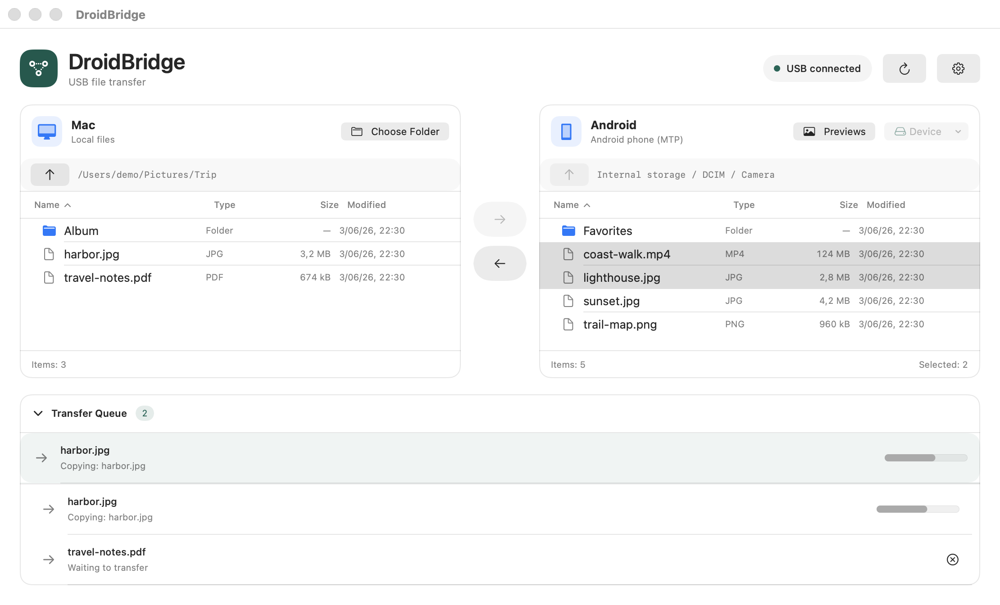
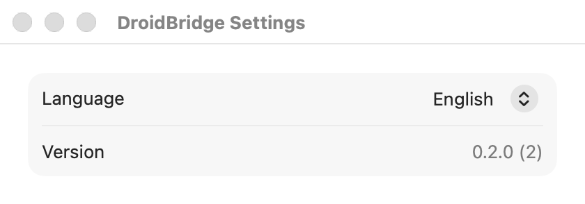

# DroidBridge

[English](README.md) · [Русский](README.ru.md) · [Español](README.es.md) · [Français](README.fr.md) · [Deutsch](README.de.md) · [Português (Brasil)](README.pt-BR.md) · [日本語](README.ja.md) · [简体中文](README.zh-Hans.md)

DroidBridge — нативное приложение macOS для передачи файлов и папок между Mac и Android по USB (MTP). В приложении есть две панели для просмотра файлов, опциональные миниатюры фото и очередь передач.



## Скачать приложение

Рекомендуем собрать DroidBridge из исходников по инструкции ниже.

[Готовый образ диска](https://github.com/chepikovdmitry/DroidBridge/releases/tag/v0.2.0) поддерживает Apple Silicon и macOS 26 или новее. Откройте образ и перетащите DroidBridge в «Программы». У сборки локальная подпись ad hoc, без нотаризации Apple. macOS может заблокировать первый запуск. Если вы доверяете загрузке, следуйте [инструкции Apple](https://support.apple.com/en-us/102445).

В релиз также входят контрольные суммы и исходники включённых библиотек. См. [условия распространения и лицензии](docs/distribution.md).

## Сборка и запуск

Нужна macOS 26 или новее. Сборка проверена на Apple Silicon.

1. Установите полное приложение Xcode из [Mac App Store](https://apps.apple.com/app/xcode/id497799835) или с [сайта Apple Developer](https://developer.apple.com/download/all/). Подойдёт Xcode 26 или новее с SDK macOS 26 или новее. Запустите Xcode и завершите первоначальную настройку.

2. Проверьте в Терминале выбранные Xcode и SDK. Если Терминал использует отдельный пакет Command Line Tools или старый Xcode, сначала выберите полное приложение. Измените путь, если Xcode установлен в другой папке.

   ```sh
   # Only if you need to select Xcode
   sudo xcode-select --switch /Applications/Xcode.app
   xcodebuild -version
   xcrun --sdk macosx --show-sdk-version
   ```

3. Если Homebrew ещё нет, запустите установщик с [brew.sh](https://brew.sh/). Выполните шаги из раздела **Next steps**, чтобы добавить Homebrew в оболочку, и проверьте командой `brew --version`.

   ```sh
   /bin/bash -c "$(curl -fsSL https://raw.githubusercontent.com/Homebrew/install/HEAD/install.sh)"
   ```

4. Клонируйте репозиторий и соберите приложение. Если вы скачали ZIP, распакуйте его, откройте папку проекта в Терминале и начните с `brew install`.

   ```sh
   git clone https://github.com/chepikovdmitry/DroidBridge.git
   cd DroidBridge
   brew install libmtp pkgconf
   ./Scripts/build-app.sh -c release
   open .build/DroidBridge.app
   ```

Приложение появится по пути `.build/DroidBridge.app` и использует библиотеки Homebrew, установленные на этом Mac.

## Подключение и копирование

1. Разблокируйте Android, подключите его USB-кабелем с передачей данных и выберите **Передача файлов** в настройках USB. Подтвердите доступ, если появится запрос. Закройте другие приложения, использующие это MTP-устройство. Отладка по USB не нужна.
2. Слева показаны файлы Mac. Кнопка **Выбрать папку** (⌘O) задаёт локальный источник или папку назначения. Справа показано хранилище Android. Открывайте папки двойным щелчком, возвращайтесь на уровень выше стрелкой вверх, сортируйте список по заголовкам столбцов. Кнопка обновления (⌘R) перезагружает списки.
3. Выделите файлы или папки. Нажмите **←** для копирования с Android на Mac или **→** для копирования с Mac на Android. Выделенные объекты также можно перетащить в соседнюю панель.
4. Вверху **Очереди передач** видны текущий файл и ход копирования. Раскройте очередь, чтобы увидеть ожидающие и завершённые передачи. Если файл уже есть на Mac, выберите **Пропустить** или **Сохранить копию**.
5. Кнопка **Превью** в панели Android включает миниатюры видимых фото и видео.

## Язык

Нажмите шестерёнку в главном окне или `⌘,`, чтобы открыть **Настройки**. Выберите один из восьми языков или язык системы. Изменение применяется сразу. Резервный язык — английский.



## Решение проблем

- **Телефон не виден.** Разблокируйте телефон, выберите «Передача файлов (MTP)» и подключите кабель с передачей данных напрямую к Mac. Закройте другие MTP-приложения, переподключите телефон и нажмите «Обновить» (⌘R).
- **Хранилище недоступно.** Если это произошло на Samsung, переключите USB в режим «Передача фото (PTP)», затем обратно в «Передача файлов (MTP)» и подтвердите доступ при запросе.
- **Копирование зависло или прервалось.** Проверьте кабель, свободное место в папке назначения и запросы о совпадении имён в очереди. При необходимости переподключите телефон и обновите список. Если не удалось скопировать файл на телефон, проверьте папку назначения на наличие частичного файла перед повтором.

[Сообщить об ошибке](https://github.com/chepikovdmitry/DroidBridge/issues/new?template=bug-report.yml) · [Сообщить об уязвимости](SECURITY.md) · [История изменений](CHANGELOG.md)

## Тесты и диагностика USB

```sh
swift build
swift test
.build/debug/droidbridge-usb --help
```

## Проверка с телефоном

Подключи один разблокированный Android-телефон кабелем с передачей данных. В настройках USB на телефоне выбери «Передача файлов» и подтверди запрос на доступ, если он появится. Закрой другие приложения, работающие с этим MTP-устройством.

```sh
.build/debug/droidbridge-usb devices
.build/debug/droidbridge-usb storages
.build/debug/droidbridge-usb ls 65537
.build/debug/droidbridge-usb ls 65537 42
```

В примере `65537` — идентификатор хранилища из `storages`, а `42` — идентификатор папки `Download` из первого `ls`. Подставь значения, выведенные твоим телефоном. После переподключения снова запроси идентификаторы.

Для двусторонней проверки создай новый небольшой файл с уникальным именем, скопируй его на телефон и скачай под другим именем. Подставь идентификатор, напечатанный командой `push`, вместо `123`.

```sh
printf 'DroidBridge USB check\n' > droidbridge-usb-check.txt
.build/debug/droidbridge-usb push droidbridge-usb-check.txt 65537 42
.build/debug/droidbridge-usb pull 123 droidbridge-usb-returned.txt
shasum -a 256 droidbridge-usb-check.txt droidbridge-usb-returned.txt
```

Обе контрольные суммы должны совпасть. Повтори с именем на кириллице и файлом больше 4 ГиБ, если хватает места. Во время передачи проверь отдельно Ctrl+C и отключение кабеля в обоих направлениях. При Ctrl+C скачивание заканчивает обмен по USB и удаляет временный файл. Начатая загрузка на телефон завершается штатно. На тестовом Samsung немедленное прерывание через libmtp оставляло MTP-сессию без ответа.

При ошибке скачивания прототип удаляет временную копию и сохраняет любой уже существующий файл по адресу назначения. Ошибка загрузки на телефон может оставить частичный файл. Перед повторной попыткой переподключи телефон, обнови список папки и проверь её содержимое. Если Samsung уже виден по USB, а хранилище остаётся недоступным, переключи «Передача фото» → «Передача файлов» на телефоне.

## Лицензия

Код DroidBridge распространяется по [лицензии MIT](LICENSE). Для [зависимости libmtp](https://formulae.brew.sh/formula/libmtp) действует отдельная лицензия LGPL-2.1-or-later.
